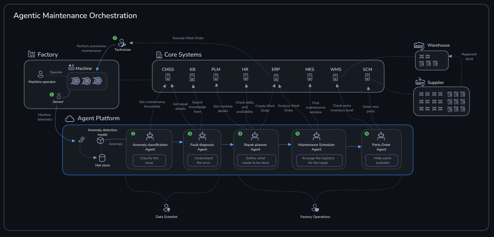
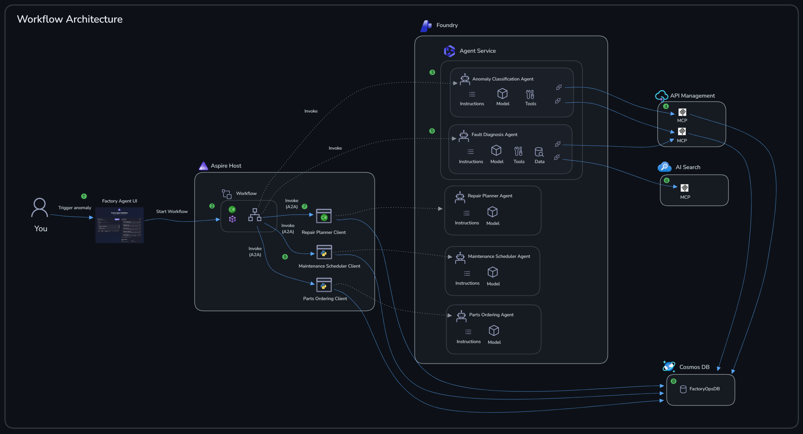

# 導覽 {#overview .factory-title}

## 情境

晶圓製造工廠的設備出現異常時，實務挑戰不只是找出根本原因，還有設備工程師需要查找維修知識，製造單位需要協調維護時段，物料人員則要確認備品是否到位。資訊若分散在不同系統與人員之間，維護準備就可能卡在反覆確認與交接，讓非預期停機的處理更難協調。

本場將觀察五個 Agent 的 factory agent workflow 如何把一筆設備警訊整理成診斷、工單、維護排程與備品準備資訊。重點不只是讓流程跑完，而是讓下一個角色拿到**可判讀、可交接的資訊**。背後是由 AI 開發團隊使用 **Microsoft Foundry、Microsoft Agent Framework 與 Aspire** 打造的 multi-agent system。

{ .factory-maintenance-workflow width="2200" height="1100" loading="eager" fetchpriority="high" }

 

### 五個 Agent 的接力 {#agent-sequence}

本次採用 sequential orchestration，讓五個 Agent 依固定順序執行：

**異常分類 → 故障診斷 → 維修規劃 → 維護排程 → 備品確認**

這個順序反映前後步驟的資訊依賴：

- **分類交給診斷**：先整理異常讀值與嚴重程度（severity），再查找可能原因與知識依據。
- **診斷交給規劃**：依可能原因整理維修工作、技能與備品需求，並建立可識別的工單。
- **工單交給排程 與 備料**：讓維護安排與備品處理對應同一張工單，而不是各自處理不同的工作。

{ .agentic-maintenance-orchestration width="1280" height="584" loading="eager" fetchpriority="high" }

 

## 目標

本場練習不連接實廠感測器（sensors），而是手動提交一筆**合成遙測資料（telemetry）**，理解廠端資料與任務如何在 Agent 之間傳遞，以及如何從工具呼叫（tool calls）、工單與追蹤記錄（traces）找到可核對的證據。

## 核心技術

Agentic Factory 的五個 Agent 採用混合語言（**Python** 與 **C# / .NET 10**）開發，並分別搭配 **Microsoft Agent Framework**、**Microsoft Foundry Agents SDK** 與 **A2A（Agent-to-Agent）**，最後由 **.NET Aspire** 統一啟動與管理這套跨語言（Python + .NET）的多 Agent 系統。

{ .workflow-architecture width="1280" height="584" loading="eager" fetchpriority="high" }

 

以下是五個 Agent 各自的程式語言、使用的 Agent 框架／SDK，以及在最終工作流程中的執行方式：

| Agent 名稱 | 程式語言 | Agent 框架 / SDK | 執行 / 串接方式 | 參考檔案 |
|---|---|---|---|---|
| Anomaly Classification Agent (異常分類) | **Python** | **Microsoft Foundry Agents SDK** | 註冊於 **Foundry Agent Service** 雲端託管；.NET workflow 透過 `Microsoft.Agents.AI` / `Azure.AI.Projects` 呼叫 | `anomaly_classification_agent.py` `anomaly_classification_agent_mcp.py` |
| Fault Diagnosis Agent (故障診斷) | **Python** | **Microsoft Foundry Agents SDK** | 註冊於 **Foundry Agent Service** 雲端託管；.NET workflow 透過 `Microsoft.Agents.AI` / `Azure.AI.Projects` 呼叫 | `fault_diagnosis_agent.py` |
| Repair Planner Agent (維修規劃) | **C# (.NET 10)** | **Microsoft Agent Framework (.NET)** + **Foundry Agents SDK (.NET)** | 在 .NET workflow 本機行程中建立 `AIAgent`，並透過 `AIFunctionFactory` 掛載本機 Cosmos DB tools | `challenge-2 README` `RepairPlannerAgentFactory.cs` |
| Maintenance Scheduler Agent (維護排程) | **Python** | **Microsoft Agent Framework (Python)** | 在 Python FastAPI/Starlette 服務中以 **A2A SDK**（`a2a-sdk`）包裝為 A2A Server，由 .NET 端透過 `Microsoft.Agents.AI.A2A` 呼叫 | `maintenance_scheduler_agent.py` `agents.py` |
| Parts Ordering Agent (零件訂購) | **Python** | **Microsoft Agent Framework (Python)** | 在 Python FastAPI/Starlette 服務中以 **A2A SDK**（`a2a-sdk`）包裝為 A2A Server，由 .NET 端透過 `Microsoft.Agents.AI.A2A` 呼叫 | `parts_ordering_agent.py` `agents.py` |

---

## 下一步 {#next}

進入 [準備](prerequisites.md)。
