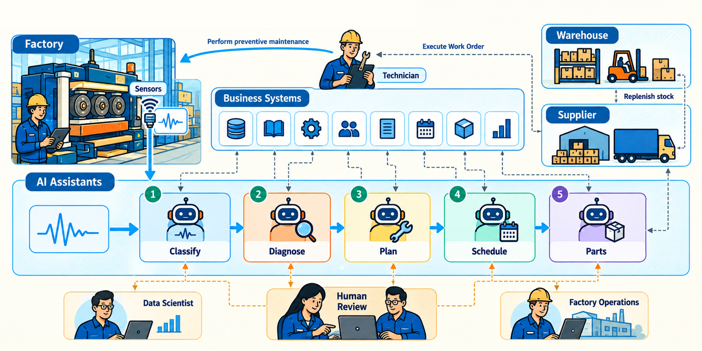

# 導覽 {#overview .factory-title}

## 情境

本教材以晶圓製造工廠作為設備維護的說明情境。設備出現異常後，挑戰不只是判斷哪裡出了問題：設備工程師需要查找維修知識，製造單位需要協調維護時段，物料人員則要確認備品是否到位。資訊若分散在不同系統與人員之間，維護準備就可能卡在反覆確認與交接，讓非預期停機的處理更難協調。

本次 hands-on workshop 使用 **Microsoft Foundry、Microsoft Agent Framework 與 Aspire**，觀察五個 Agent 如何把一筆設備警訊整理成診斷、工單、維護排程與備品準備資訊。重點不只是讓流程跑完，而是讓下一個角色拿到**可判讀、可交接的資訊**。

 

{ .factory-maintenance-workflow width="2200" height="1100" loading="eager" fetchpriority="high" }

 

### 五個 Agent 如何協作 {#agents}

把五個 Agent 看成設備、製造與物料單位協作的縮影，而不是五個聊天視窗。每一步都要留下下一個角色可接手的資訊：

| 順序 | Agent | 交棒資訊與業務用途 | 目前 Challenge 4 的呼叫方式 |
|---|---|---|---|
| 1 | Anomaly Classification Agent | 整理異常與嚴重程度（severity），讓後續診斷聚焦需要關注的讀值。 | Foundry Agent Service，使用 remote MCP tools |
| 2 | Fault Diagnosis Agent | 提供可能原因、知識依據與檢查方向，供維修規劃判讀。 | Foundry Agent Service，使用 MCP／knowledge |
| 3 | Repair Planner Agent | 把診斷轉成工單、技能與備品需求，讓排程與備料有共同的工作對象。 | VM 內 .NET workflow 的流程內呼叫，使用 Cosmos DB tools |
| 4 | Maintenance Scheduler Agent | 提出維護時間與相關安排，協助考量維護急迫性與生產時段。 | VM 內 Python service，透過 HTTP A2A 呼叫 |
| 5 | Parts Ordering Agent | 依工單檢查備品與補購需求，提早辨識可能造成等待的缺料條件。 | VM 內 Python service，透過 HTTP A2A 呼叫 |

## 目標

本次練習不連接實廠感測器（sensors），而是手動提交一筆**合成遙測資料（telemetry）**。我們將注意力放在資料如何在 Agents 之間傳遞，以及如何從工具呼叫（tool calls）、工單與追蹤記錄（traces）找到可核對的證據。完成五個 Tasks 後，你應能：

- 使用 Aspire 啟動 .NET、Python 與 frontend 組成的應用程式。
- 解釋五個 Agent 的分工，以及 sequential orchestration 的依賴順序。
- 分辨 Foundry 託管 Agents、VM 內的 .NET agent，以及 Python HTTP A2A 的呼叫邊界。
- 從 UI、Console 與 Traces 追蹤一次操作，而不只相信模型回答「已完成」。

## 步驟

每頁都提供操作、完成條件與疑難排解。若前置條件尚未滿足，請先向講師確認，不要跳過失敗步驟。完成條件是供自行核對的清單，網站不儲存學員進度。需要協助時，可先查閱全站 [疑難排解](troubleshooting.md)，若仍無法解決，請舉手讓講師知道。

工作坊檔案請至 [工作坊下載](workshop-downloads.md)，依原表組別點選 STD 檔名；45 個檔案皆已提供下載連結。

| 頁面 | 你要做的事 | 要看到的結果 |
|---|---|---|
| [準備](prerequisites.md) | 確認遠端桌面、工具與既有環境 | 可以在指定 VM 內開啟 repository 與 Terminal |
| [Task 1：啟動 Aspire](tasks/task-1-start-aspire.md) | 啟動服務 | 可找到 frontend、workflow 與 Python service |
| [Task 2：確認 Workflow API 連線](tasks/task-2-api-access.md) | 在 VM 內檢查 API | `/health` 有回應，API URL 指向正確服務 |
| [Task 3：開啟 frontend](tasks/task-3-open-frontend.md) | 進入操作 UI | 看見 Machine ID、Telemetry 與五個 Agent 面板 |
| [Task 4：執行 workflow](tasks/task-4-run-workflow.md) | 觸發一筆合成異常 | 核對五步的實際輸出與 tool results |
| [Task 5：檢視 dashboard](tasks/task-5-observe-dashboard.md) | 查看 Console 與 Traces | 能說明同一次操作的呼叫順序與問題位置 |

---

## 下一步 {#next}

進入 [準備](prerequisites.md)。
