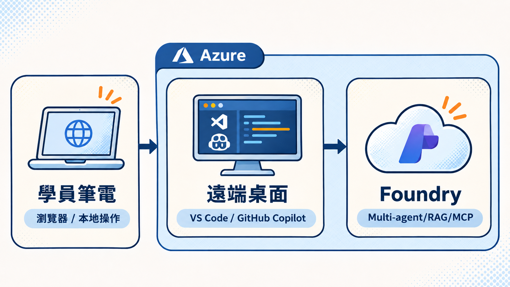
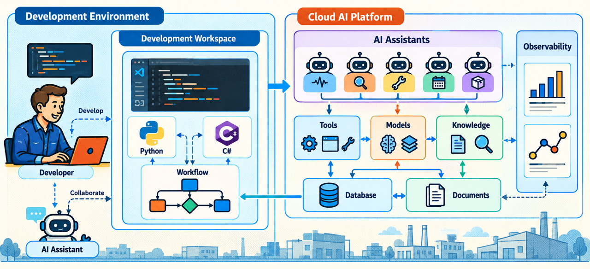

# 準備 {#preparation}

## 環境說明 {#environment}

在開始 Task 1 前，確認您已進入講師提供的 **Ubuntu 遠端桌面**，並使用講師指定的登入方式、VM、repository 路徑與 Azure 身分。講師已準備好環境建置、權限、模型、Agents 與資料試跑，不由學員現場重複建立。

<br/>

{ .workshop-env-architecture width="1672" height="941" loading="eager" fetchpriority="high" }

<br/>

### 兩個瀏覽器，用途不一樣

| 所在位置 | 用途 |
|---|---|
| 自己電腦的瀏覽器 | 閱讀 GitHub Pages 教材，以及進入講師指定的遠端桌面入口 |
| Ubuntu 桌面內的瀏覽器 | 開啟 VM 內的 frontend 與 Aspire dashboard |

## Checklist {#checklist}

- [ ] 能進入自己被指派的 Ubuntu 遠端桌面。
- [ ] VM 內可找到正確的 repository 與 `apphost.cs`。
- [ ] 必要工具可以使用，且 Azure CLI 的身分／subscription 符合講師交付。
- [ ] 依非機密個人環境清單，確認專案、資料庫與 Agent 設定符合自己的分配。

### 1. 確認工具與 repository

在 **Ubuntu VM 內**開啟 Terminal，切換到講師提供的 repository 根目錄。
先確認能找到 workflow 的入口：

```bash
ls challenge-4/agent-workflow/apphost.cs
```

再確認工具可以使用：

```bash
dotnet --list-sdks
aspire --version
uv --version
node --version
npm --version
az version
```

| 工具 | 要確認的事 |
|---|---|
| .NET SDK | 有支援 `net10.0` 專案的 .NET 10 SDK |
| Aspire CLI | 可以執行 `aspire run`；AppHost 使用 Aspire 13.6.5 套件 |
| uv／Python | 可使用 Agent app 要求的 Python 3.13 環境 |
| Node.js／npm | 能執行 repository 的 Vite 7 frontend |
| Azure CLI | 已具備講師指定身分的登入與必要權限 |

### 2. 確認 Azure CLI，並登入成功

在同一個 VM Terminal 內確認 Azure CLI 已登入：

```bash
az account show --query name --output tsv
```

確認顯示的是講師指定的 subscription。若尚未登入或不正確，依講師提供的方式處理；
不要自行切換共用服務的身分或修改 Azure 權限。

### 3. 核對個人環境與設定檔

依講師提供的**非機密個人環境清單**，確認 `WORKSHOP_STUDENT_ID`、指定的 Foundry 專案與模型部署，以及 Cosmos DB 資料庫和各 Agent 的名稱／版本符合自己的分配。資料庫名稱應與個人 ID 相符（例如 `FactoryOpsDB_s01`）；若不一致或無法確認，請先詢問講師。

既有程式會讀取 repository 根目錄的 `.env`。只檢查檔案是否存在，不要用 `cat`、`echo` 或其他方式輸出內容：

```bash
if [ -f .env ]; then
  printf '已找到 .env；請勿公開內容。\n'
else
  printf '找不到 .env，請聯絡講師。\n' >&2
  false
fi
```

不要分享或提交 `.env`，也不要公開其中的金鑰、Token 或連線資訊。僅確認檔案存在，不能證明雲端資源可連線；後續仍需依 Task 2 的檢查與講師提供的方式確認。

## 準備開始 {#get-ready}

<br/>

{ .factory-maintenance-architecture width="1280" height="584" loading="eager" fetchpriority="high" }

<br/>

## 下一步 {#next}

進入 [Task 1：啟動 Aspire](tasks/task-1-start-aspire.md)。