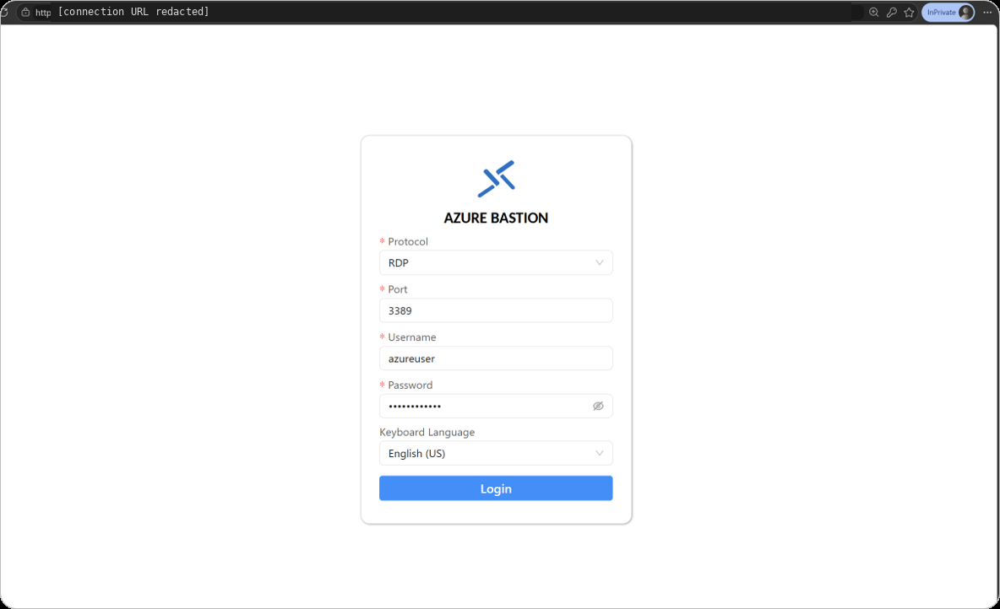
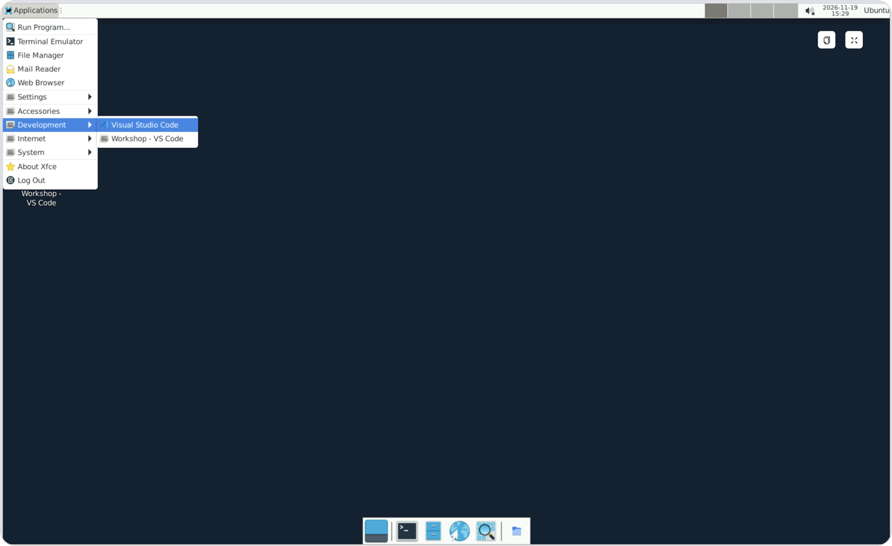
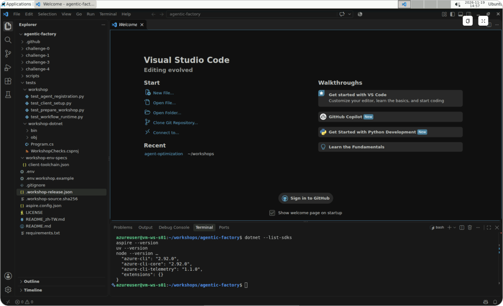

# 準備 {#preparation}

## 環境說明 {#environment}

在開始 Task 1 前，確認您已進入講師提供的 **Ubuntu 遠端桌面**，並使用講師指定的登入方式、VM、repository 路徑與 Azure 身分。講師已準備好環境建置、權限、模型、Agent 與資料試跑，不由學員現場重複建立。

 

{ .workshop-env-architecture width="1672" height="941" loading="eager" fetchpriority="high" }

 

### 兩個瀏覽器，用途不一樣

| 所在位置 | 用途 |
|---|---|
| 自己電腦的瀏覽器 | 閱讀 GitHub Pages 教材，以及進入講師指定的遠端桌面入口 |
| Ubuntu 桌面內的瀏覽器 | 開啟 VM 內的 frontend 與 Aspire dashboard |

## 完成條件

- [ ] 已進入自己被指派的遠端桌面。
- [ ] 已確認專案、資料庫與 Agent 設定符合自己的分配。
- [ ] 已確認遠端桌面中使用 VS Code 進入工作目錄 `agentic-factory`。

### 1．遠端桌面登入 {#1}

{ .vm-ubuntu-rdp width="1672" height="1020" loading="eager" fetchpriority="high" }

 

### 2．VS Code 進入工作目錄 `agentic-factory` {#2-vs-code-agentic-factory}

{ .development-vs-code width="1672" height="1023" loading="eager" fetchpriority="high" }

 

{ .vs-code-agentic-factory width="1672" height="1020" loading="eager" fetchpriority="high" }

 

## 步驟

這次操作的不是五個獨立的聊天視窗，而是由 frontend、workflow、Agent 與工具共同組成的 multi-agent application。接下來的四個 Task，可以從操作對照背後的概念：

| 本次操作 | 學習重點 |
|---|---|
| [Task 1：啟動 Aspire](tasks/task-1-start-aspire.md) | 從 Resources 與 Graph 辨識 .NET、Python 與 frontend，理解一個應用程式可以由多個服務組成。 |
| [Task 2：開啟 frontend](tasks/task-2-open-frontend.md) | 使用者透過同一個 UI 提交任務，不需要逐一操作每個 Agent。 |
| [Task 3：執行 workflow](tasks/task-3-run-workflow.md) | Agent 透過工具取得資料或執行動作，再把結果交給後續步驟。 |
| [Task 4：檢視 dashboard](tasks/task-4-observe-dashboard.md) | 使用 Console 與 Traces 追蹤同一次操作的順序、耗時與錯誤，而不只看最後的文字回答。 |

---

## 下一步 {#next}

進入 [Task 1：啟動 Aspire](tasks/task-1-start-aspire.md)。