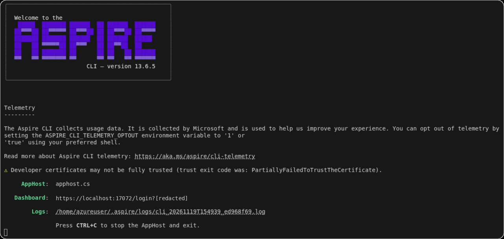
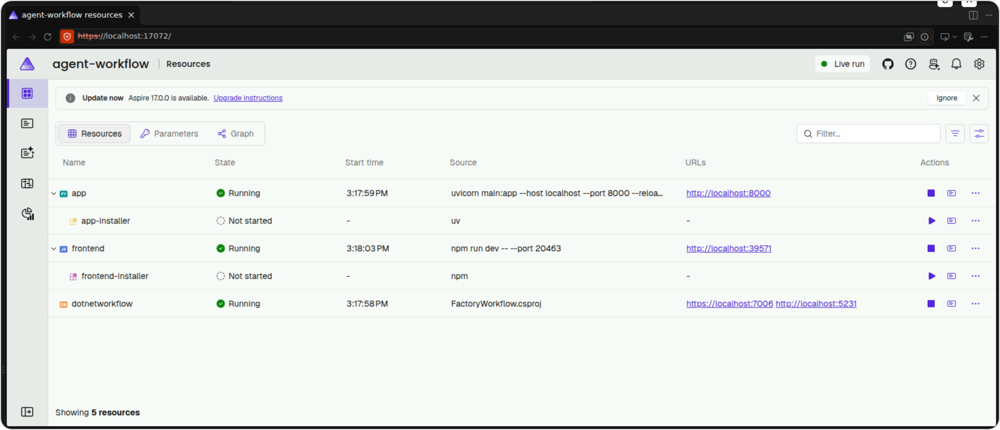
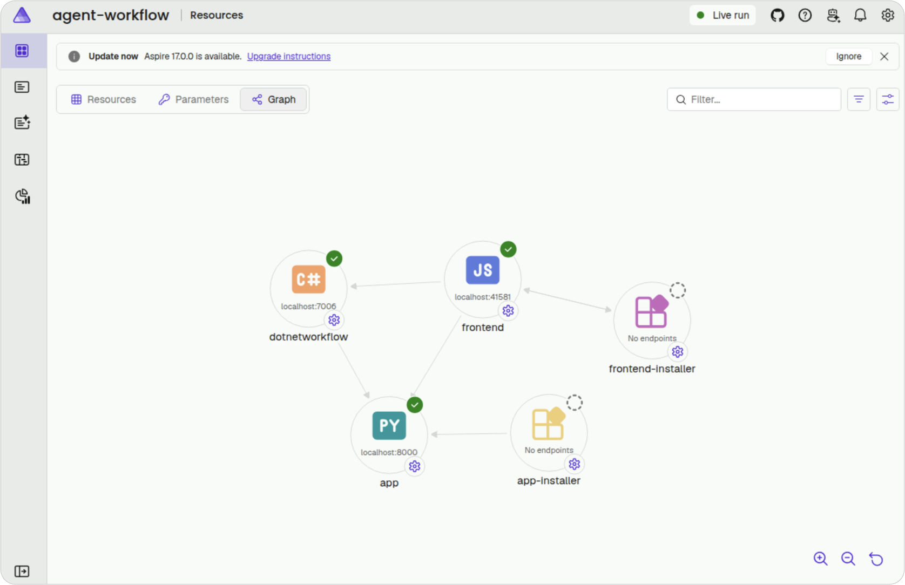

# Task 1：啟動 Aspire {#start-aspire}

## 目標 {#goal}

在遠端桌面中，啟動既有 multi-agent application，並找到 frontend、workflow API 與 Python Agent 的執行資源。

## 完成條件 {#checklist}

- [ ] 順利啟動 Aspire 應用程式，沒有未處理的啟動錯誤。
- [ ] 順利連線 Aspire dashboard，並確認三個服務正常運作——`app`、`frontend` 與 `dotnetworkflow`。

## 步驟 {#steps}

### 1．啟動 Aspire 應用程式

在遠端桌面的 VS Code 中，開啟 Terminal 後輸入：

```bash
cd challenge-4/agent-workflow
aspire run
```

並保持這個 Terminal 開啟，不要按 `Ctrl+C`。

{ .aspire-run width="3022" height="1438" loading="lazy" }

*圖 1：Aspire 的啟動畫面。*

<br/>

### 2．開啟 Aspire 的 dashboard

Aspire 提供 dashboard 連結，並啟動這三個服務。請查看這三個服務的狀態是否都顯示 `Running`。

| 資源 | 用途 |
|---|---|
| `app` | Python app，提供 Maintenance Scheduler 與 Parts Ordering 的 A2A 路徑 |
| `dotnetworkflow` | .NET workflow API 與 VM 內的 Repair Planner |
| `frontend` | 學員操作的 Factory Agent Workflow UI |

{ .aspire-dashboard width="3022" height="1301" loading="lazy" }

*圖 2：Aspire 的 Resources 頁面。*

<br/>

### 3．開啟 Aspire 的 Graph

**Aspire 管理應用服務，Agent Framework 定義 Agent workflow**，兩者的責任不同。Agent 的程式執行位置也不等於模型執行位置；VM 內的 Agent 仍會使用雲端模型服務。透過 Graph 頁面，我們將看到統一啟動、分散式執行的跨語言 multi-agent 系統。

### 背後的應用架構 {#application-architecture}

五個 Agent 不需要使用相同語言，也不一定在相同位置執行。各元件的用途如下：

| 元件 | 用途 |
|---|---|
| Frontend | 提交 Machine ID 與 Telemetry，呈現執行進度、tool calls 與 Agent output。 |
| .NET workflow／Microsoft Agent Framework | 串接五個 Agent，定義執行順序與結果交接。 |
| Foundry Agent Service | 託管 Anomaly Classification 與 Fault Diagnosis，由 .NET workflow 呼叫。 |
| VM 內的 Repair Planner | 在 .NET workflow 行程內建立 Agent，搭配本機 tools 存取 Cosmos DB，不是另一個 Python A2A 服務。 |
| Python A2A 服務 | 由 `app` 提供 Maintenance Scheduler 與 Parts Ordering，透過 HTTP A2A 與 .NET workflow 串接。 |
| Aspire | 統一啟動與管理應用服務，集中呈現 Resources、Graph、Console 與 Traces。 |


{ .aspire-graph width="3022" height="1955" loading="lazy" }

*圖 3：Aspire 的 Graph 子頁面。*

---

## 下一步 {#next}

進入 [Task 2：開啟 frontend](task-2-open-frontend.md)。
