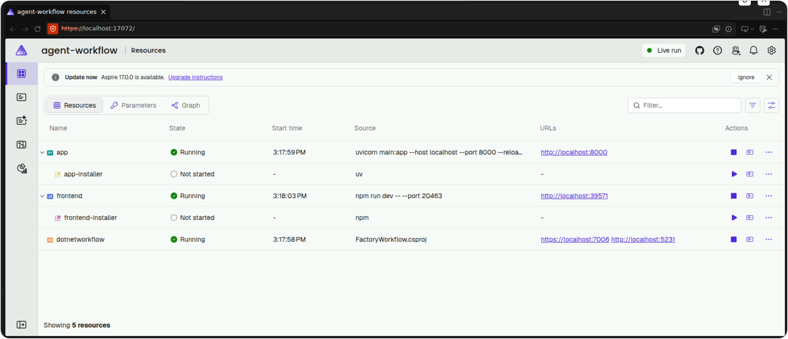
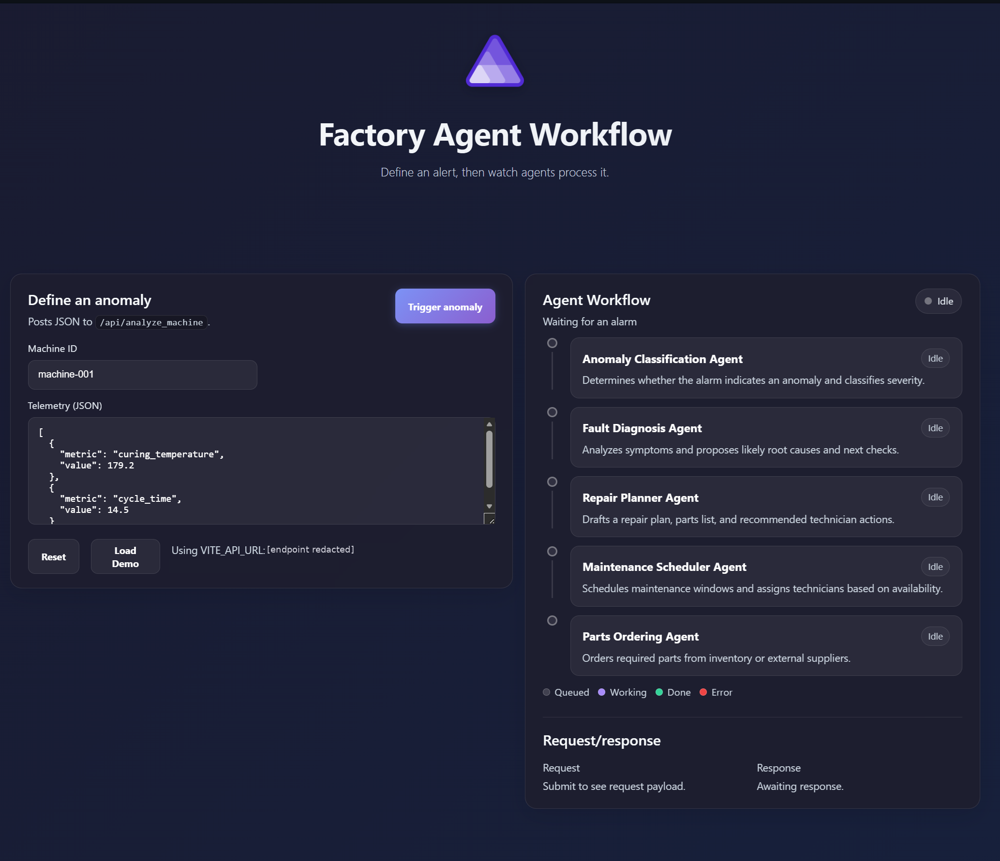

# Task 2：開啟 frontend {#open-frontend}

## 目標 {#goal}

在遠端桌面內開啟 Factory Agent Workflow UI，辨識提交異常與觀察 Agent 的操作區域；本 Task 只檢查設定，不送出資料。

## 完成條件 {#checklist}

- [ ] 順利開啟 frontend。
- [ ] 理解 Machine ID、Telemetry、Trigger anomaly 與五個 Agent 角色。

## 步驟 {#steps}

### 1．找到 frontend 連結

在 Aspire 的輸出或 dashboard **Resources** 中，找到 `frontend` 的 HTTP endpoint。

{ .aspire-frontend width="3022" height="1301" loading="lazy" }

*圖 1：Aspire Resources 頁面。*

 

### 2．兩個操作區域的用途

| 區域 | 觀察的內容 |
|---|---|
| **Define an anomaly** | Machine ID、遙測資料（Telemetry，JSON）、Trigger anomaly 按鈕 |
| **Agent Workflow** | 五個 Agent 的角色、目前狀態，以及執行後的輸出 |

您會看到這五個 Agent 角色依序排列：

1. Anomaly Classification Agent（異常分類）
2. Fault Diagnosis Agent（故障診斷）
3. Repair Planner Agent（維修規劃）
4. Maintenance Scheduler Agent（維護排程）
5. Parts Ordering Agent（零件訂購）

{ .workshop-figure width="2067" height="1781" loading="lazy" }

*圖 2：Factory Agent Workflow 畫面。*

 

### 3．確認 API URL，先不要送出

在表單下方核對 `Using VITE_API_URL` 是否對應 Aspire dashboard **Resources** 中 `dotnetworkflow` 的 HTTP endpoint，
起始狀態通常為 Idle／Waiting for an alarm，在下一個 Task 才提交一次合成異常。

---

## 下一步 {#next}

進入 [Task 3：執行 workflow](task-3-run-workflow.md)。
