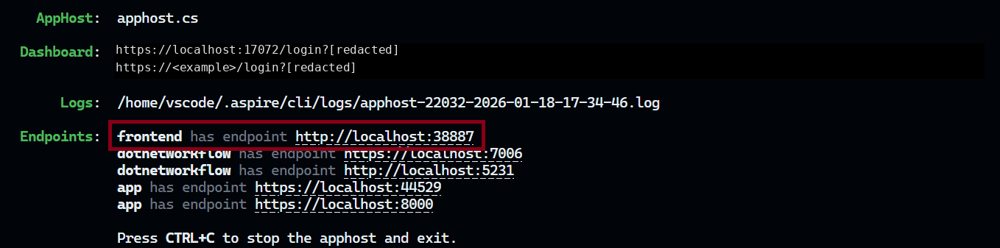
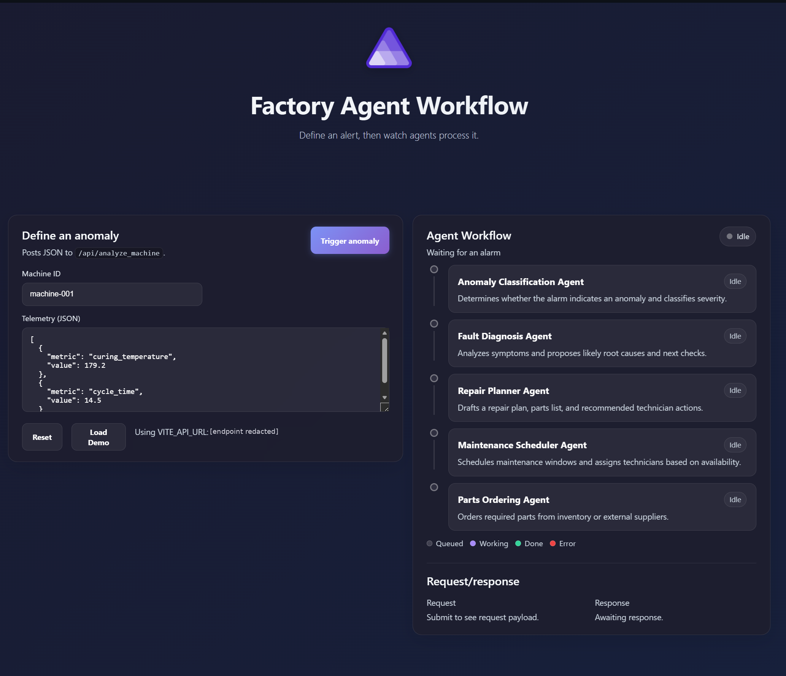

# Task 3：開啟 frontend {#open-frontend}

## 目標 {#goal}

在遠端桌面內開啟 Factory Agent Workflow UI，辨識提交異常與觀察 Agents 的操作區域；本 Task 只檢查設定，不送出資料。

!!! tip "維護現場觀點"
    把五個 Agent 面板當作維護協作的進度看板：後續不只看是否完成，也要看每個角色留下什麼資訊，以及下一個角色能否接手。

## 步驟 {#steps}

### 1．找到 frontend 連結

在 Aspire 的輸出或 dashboard **Resources** 中，找到 `frontend` 的 HTTP endpoint。

{ .workshop-figure width="1358" height="337" loading="lazy" }

*圖片 1：原始教材示意畫面；實際網址以 dashboard 顯示為準。*

### 2．兩個操作區域的用途

| 區域 | 要觀察的內容 |
|---|---|
| **Define an anomaly** | Machine ID、遙測資料（Telemetry，JSON）、Trigger anomaly 按鈕 |
| **Agent Workflow** | 五個 Agent 的角色、目前狀態，以及執行後的輸出 |

你應看到這五個角色依序排列：

1. Anomaly Classification Agent
2. Fault Diagnosis Agent
3. Repair Planner Agent
4. Maintenance Scheduler Agent
5. Parts Ordering Agent

{ .workshop-figure width="2067" height="1781" loading="lazy" }

*圖片 2：原始教材示意畫面；實際介面與執行狀態可能不同。*

### 3．確認 API URL，先不要送出

在表單下方核對 `Using VITE_API_URL` 是否對應 Task 2 的 workflow endpoint，
起始狀態通常為 Idle／Waiting for an alarm，在下一個 Task 才提交一次合成異常。

## 完成條件 {#checklist}

- [ ] 順利開啟 frontend。
- [ ] 理解 Machine ID、Telemetry、Trigger anomaly 與五個 Agent 角色。
- [ ] 已確認 `VITE_API_URL` 指向預期的 workflow API。

## 下一步 {#next}

進入 [Task 4：執行 workflow](task-4-run-workflow.md)。

## 疑難排解 {#troubleshooting}

??? question "Frontend 連結打不開"
    查看 `frontend` 的資源狀態與 Console，確認 Vite 是否已啟動，以及是否仍在等待 `app`／`dotnetworkflow`。
    若是 hostname 或瀏覽器位置問題，回到 [Task 2](task-2-api-access.md)，確認在 VM 內使用正確的 localhost。

??? question "畫面與截圖不同"
    截圖來自原 repo，版本、port 與外觀可能不同。
    以必要的表單欄位、五個角色與實際 endpoint 為核對依據，不需要讓畫面與截圖逐像素一致。
