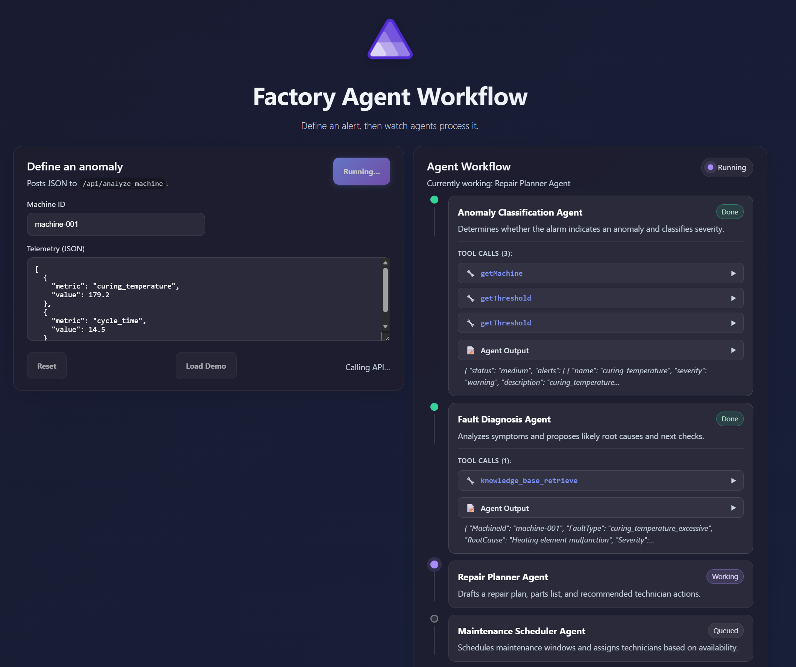
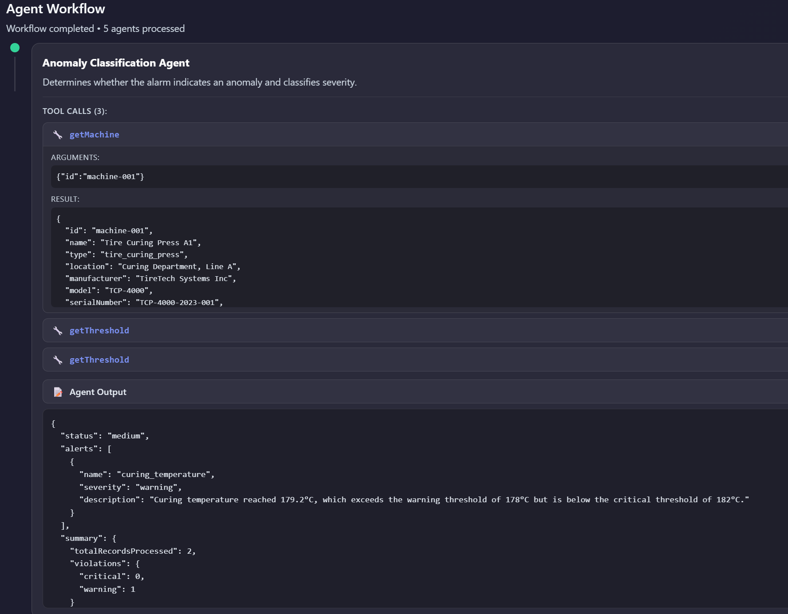
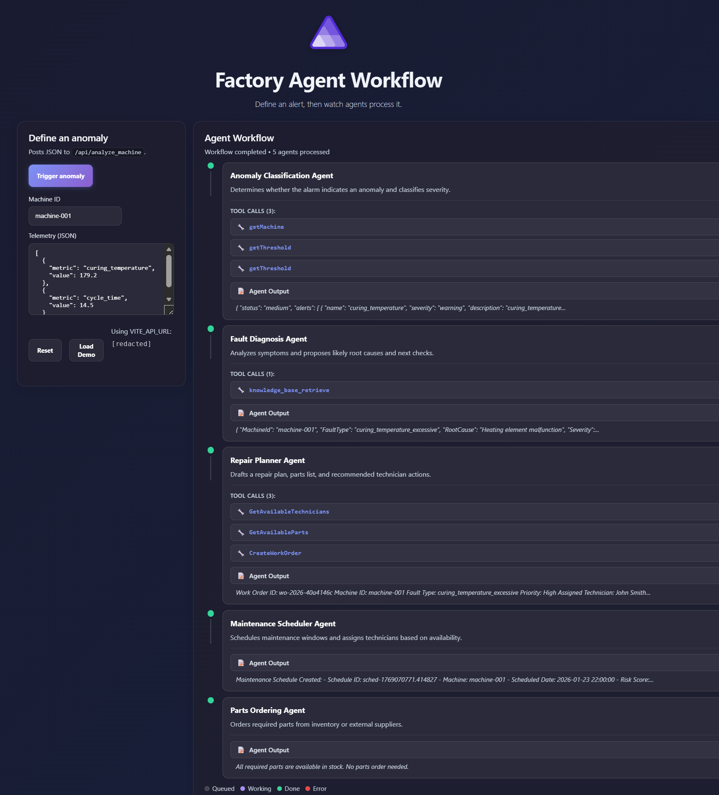

# Task 3：執行 workflow {#run-workflow}

## 目標 {#goal}

提交一筆合成異常資料後，觀察五個 Agent 的 sequential workflow，並核對每個步驟的 Agent 輸出、工單識別碼與工具結果（tool results）。

## 完成條件 {#completion}

- [ ] 使用 Trigger anomaly 提交一次 request，並記錄操作時間與 Machine ID。
- [ ] 逐一檢視五個 Agent 的輸出，確認前後步驟處理的是同一次操作。

## 步驟 {#steps}

### 1．使用範例資料

使用 frontend 的範例 Machine ID `machine-001`，預設 Telemetry 內容如下：

```json
[
  {
    "metric": "curing_temperature",
    "value": 179.2
  },
  {
    "metric": "cycle_time",
    "value": 14.5
  }
]
```

硫化溫度的預警門檻為 `178°C`，範例數值為 `179.2°C` 高於預警門檻。但這不是「某個零件已故障」的結論，後續仍需要透過機台資料與維修知識佐證可能的根本原因。

### 2．提交一次異常資料

按一下 **Trigger anomaly**，不要使用 `Load Demo` 取代 API 執行。
本次 frontend 會對 workflow API 的 `/api/analyze_machine/stream` 提交資料，並使用 SSE 接收進度。

!!! warning "請避免連續提交"
    提交時會產生模型 Token 費用，並在指定資料庫中建立工單、排程或訂單紀錄。
    請一次提交一筆，並等待結果後再決定是否重試，**請避免連續觸發**。

<br/>

### 3．觀察五個 Agent 的工作順序 {#3-5-agent}

沿著這次提交的 Machine ID（預設為 `machine-001`），依序追蹤**異常 → 診斷 → 新建工單 → 排程 → 備品確認**。工單是排程與備料共同的工作對象；取得新工單 ID 後，後續結果都應對得上同一張工單，而不是教材截圖中的舊工單。

| Agent | 要問的問題 |
|---|---|
| Anomaly Classification | 異常分類與 severity 是什麼？使用了哪些機台或 threshold 資料？ |
| Fault Diagnosis | 哪些證據支持可能原因？診斷結果與上一個步驟是否一致？ |
| Repair Planner | 是否使用 tools 取得資料、建立工單？有沒有明確的工單識別碼？ |
| Maintenance Scheduler | 是否找到同一張工單？有沒有可核對的排程結果或失敗原因？ |
| Parts Ordering | 是否處理同一張工單的備品需求？結果是不需訂購、已建立訂單紀錄，還是資料不足或失敗？ |

{ .workshop-figure width="2116" height="1773" loading="lazy" }

*圖 1：Agent workflow 依序工作的畫面。*

### 4．展開 Tool calls 與 Agent output {#4-tool-calls-agent-output}

展開各步驟的詳細資訊，辨識 tool name、arguments、result 與 Agent output。
Agent 文字摘要和 tool 回應是不同的證據；例如「已建立工單」要能對應到成功的工具回應與工單 ID。

**從設備異常的維護來看**，診斷是否有依據，工單是否確實建立，排程與備品結果是否對應同一張工單？這些證據能幫助團隊判斷下一步要補資料、處理服務問題，還是交由負責人審核維護安排，而不是只停在「流程已完成」。

{ .workshop-figure width="1775" height="1385" loading="lazy" }

*圖 2：Anomaly Classification Agent 的 Tool calls 和 Output 畫面。*

<br/>

{ .workshop-figure width="1735" height="1918" loading="lazy" }

*圖 3：端到端五個 Agent 的工作交接畫面。*

---

## 下一步 {#next}

進入 [Task 4：檢視 dashboard](task-4-observe-dashboard.md)。
