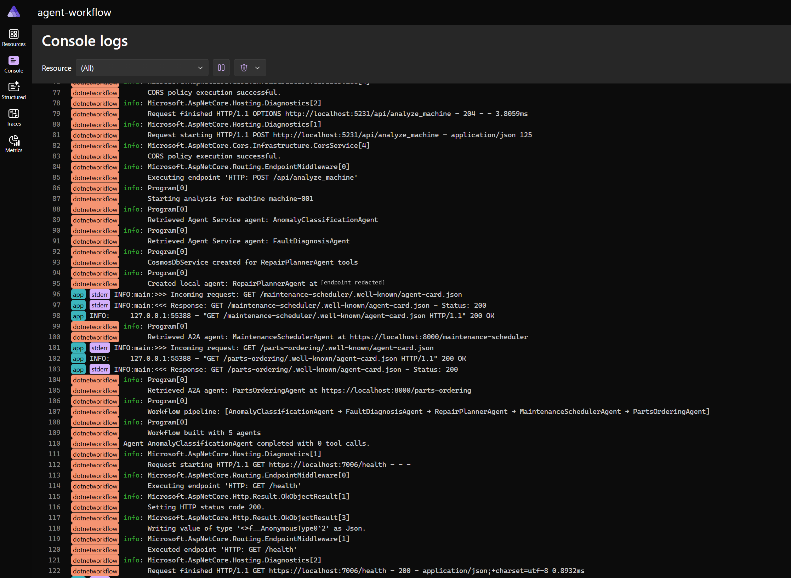
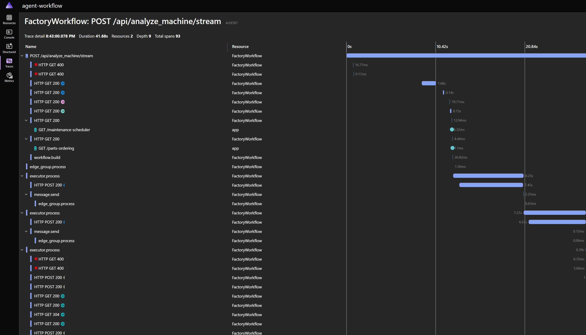

# Task 4：檢視 dashboard {#observe-dashboard}

## 目標 {#goal}

從 Aspire dashboard 追蹤 Task 3 的同一次操作，使用 Console 與 Traces 理解呼叫順序、耗時及錯誤位置。

## 完成條件 {#checklist}

- [ ] 在 Console 找到本次 request，確認是否記錄 `Workflow built with 5 agents`，並確認有無錯誤；若有，記下第一個錯誤的位置。
- [ ] 在 Traces 找到對應時間與服務的 spans，以及可說明的呼叫順序與耗時。

## 步驟 {#steps}

### 1．查看 Console logs

開啟 **Console／Console logs**，選擇 `dotnetworkflow`，依 Task 3 的操作時間找出本次 request。
再查看 `app`，觀察 Python A2A 呼叫、初始化或資料存取問題。

可核對的重點包括：

- .NET 接到哪一筆範例機台 request。
- 實際建立的 Agent 數量；目前程式會記錄 `Workflow built with ... agents`。
- 是否看到 `Workflow built with 5 agents`；若 request 失敗，記下第一個錯誤及發生位置。
- A2A Agent 是否 discovery／呼叫成功，是否出現錯誤或工單不存在。

{ .workshop-figure width="2234" height="1634" loading="lazy" }

*圖 1：Aspire 的 Console logs 頁面。*

 

### 2．查看 Traces

開啟 **Traces**，以操作時間、服務與可用的 request 資訊找到同一次呼叫。展開 trace 的追蹤區段（spans），觀察 workflow、Agent invocations、HTTP 或 tool 相關紀錄。

可核對的重點包括：

1. Request 從哪個服務進入？
2. 哪些 Agent 呼叫屬於同一次操作？順序是否符合 sequential workflow？
3. 最長的 span 是哪一段？它代表模型、tool、HTTP 呼叫還是其他處理？
4. 若有失敗，哪個 span 或 log 提供第一個明確錯誤？

{ .workshop-figure width="3043" height="1739" loading="lazy" }

*圖 2：Aspire 的 Traces 頁面。*

---

## 下一步 {#next}

閱讀 [結論](../review.md)，整理本次流程與觀察結果。
