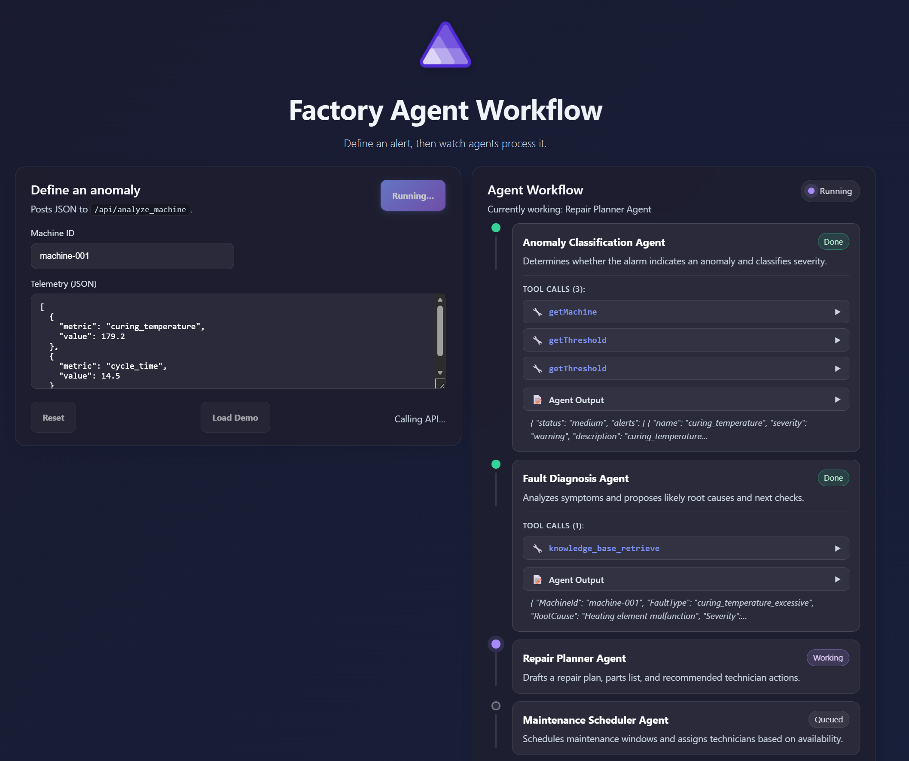
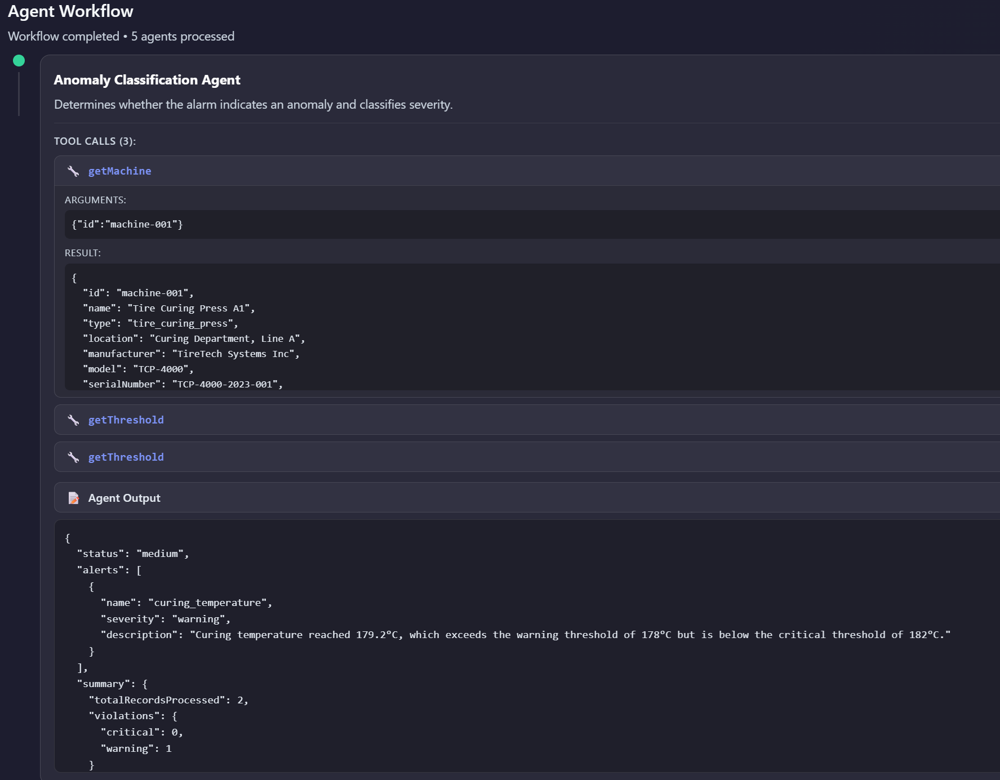
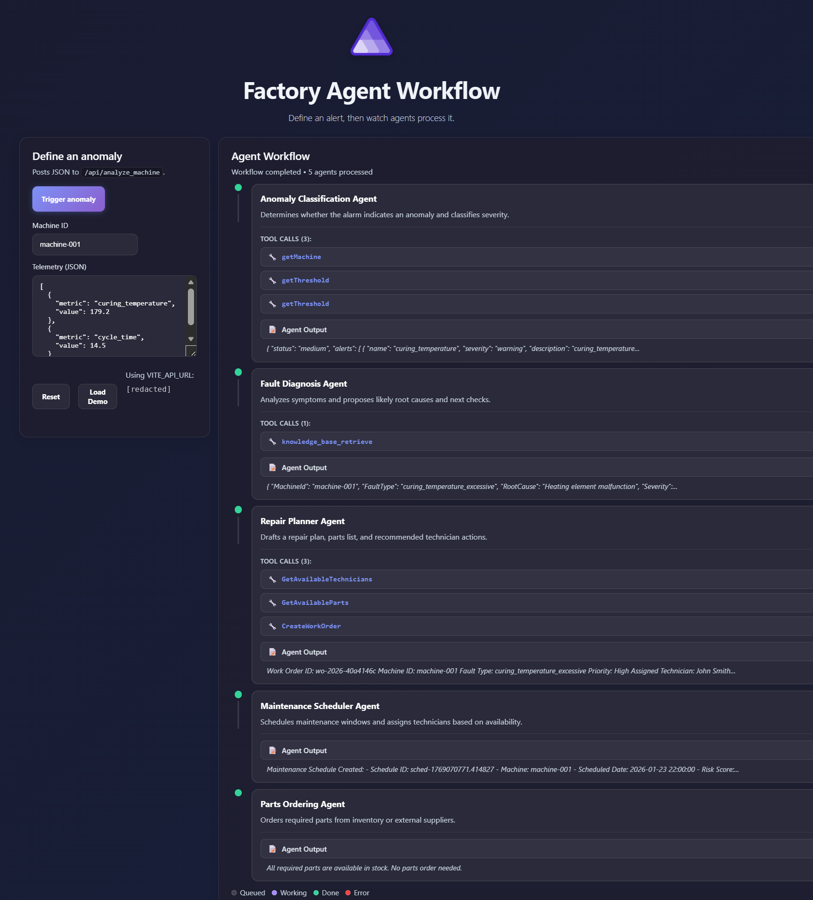

# Task 4：執行 workflow {#run-workflow}

## 目標 {#goal}

提交一筆合成異常，觀察五個 Agent 的 sequential workflow，
並核對各步驟輸出、工單識別碼與工具結果（tool results）。

!!! tip "維護現場觀點"
    維護準備常需要反覆確認原因、所需技能、可用時段與備品。這次用同一筆異常，觀察 Agents 如何把分散資訊整理成可交接的工單與後續安排。

## 步驟 {#steps}

### 1. 使用範例資料

保留 frontend 的範例 Machine ID `machine-001`，或使用講師已確認存在的範例機台。預設 Telemetry 內容如下：

```json
[
  {
    "metric": "curing_temperature",
    "value": 179.2
  },
  {
    "metric": "cycle_time",
    "value": 14.5
  }
]
```

確保 JSON 有效、機台與資料庫一致。

以教材資料為例，硫化溫度的預警門檻為 `178°C`，範例讀值 `179.2°C` 高於它。這是需要關注的觀察，還不是「某個零件已故障」的結論；後續仍需用機台資料與維修知識支持診斷。請以本次工具實際取得的機台與門檻資料核對。

### 2. 提交一次異常資料

!!! warning "請避免連續提交"
    提交時會產生模型 Token 費用，並在指定資料庫中建立工單、排程或訂單紀錄。
    請一次提交一筆，並等待結果後再決定是否重試，**請避免連續觸發**。

按一下 **Trigger anomaly**，不要使用 `Load Demo` 取代 API 執行。
本次 frontend 會對 workflow API 的 `/api/analyze_machine/stream` 提交資料，並使用 SSE 接收進度。

記錄這次操作的時間與範例 Machine ID，方便下一個 Task 找到同一次 request。

### 3. 觀察五個 Agent 的工作順序 {#3-5-agent}

沿著這次提交的 Machine ID（預設為 `machine-001`），依序追蹤**異常 → 診斷 → 新建工單 → 排程 → 備品確認**。工單是排程與備料共同的工作對象；取得新工單 ID 後，後續結果都應對得上同一張工單，而不是教材截圖中的舊工單。

| 順序 | 要問的問題 |
|---|---|
| Anomaly Classification | 異常分類與 severity 是什麼？使用了哪些機台或 threshold 資料？ |
| Fault Diagnosis | 哪些證據支持可能原因？診斷結果與上一個步驟是否一致？ |
| Repair Planner | 是否使用 tools 取得資料、建立工單？有沒有明確的工單識別碼？ |
| Maintenance Scheduler | 是否找到同一張工單？有沒有可核對的排程結果或失敗原因？ |
| Parts Ordering | 是否處理同一張工單的備品需求？結果是不需訂購、已建立訂單紀錄，還是資料不足或失敗？ |

{ .workshop-figure width="2116" height="1773" loading="lazy" }

*圖片 1：原始教材示意畫面；本次輸出、耗時及工具回應以實際操作為準。*

### 4. 展開 Tool calls 與 Agent output

展開各步驟的詳細資訊，辨識 tool name、arguments、result 與 Agent output。
Agent 文字摘要和 tool 回應是不同的證據；例如「已建立工單」要能對應到成功的工具回應與工單 ID。

!!! info "沒有訂單，也可能是合理的備料結果"
    備品足夠時，結果可能是不需訂購；需要補購時，才會嘗試建立訂單紀錄。兩種結果都要核對同一張工單的備品需求與實際資料，不能只看有沒有訂單。
    本練習的訂單是資料庫中的紀錄，不代表已向外部供應商正式下單；若資料不足或工具失敗，應標示尚未完成確認。

{ .workshop-figure width="1775" height="1385" loading="lazy" }

*圖片 2：原始教材示意畫面，呈現第一個 Agent 的工具呼叫與輸出。*

{ .workshop-figure width="1735" height="1918" loading="lazy" }

*圖片 3：原始教材示意畫面，呈現五個 Agent 的工具呼叫與輸出。*

## 完成條件 {#completion}

- [ ] 使用 Trigger anomaly 提交一次 request，並記錄操作時間與 Machine ID。
- [ ] 逐一檢視五個 Agent 的輸出，確認前後步驟處理的是同一次操作。
- [ ] 若已建立工單，記錄工單識別碼與建立工具的結果，並核對後續排程和備品步驟是否引用同一張工單。
- [ ] 若步驟失敗或證據不足，記下第一個錯誤及其位置，標示尚未完成；不要只依 UI 顯示或 Agent 摘要判定業務成功。

## 下一步 {#next}

進入 [Task 5：檢視 dashboard](task-5-observe-dashboard.md)。

## 疑難排解 {#troubleshooting}

??? question "401／403 或找不到 Foundry project"
    查看 `dotnetworkflow`／`app` Console 的具體服務與錯誤。
    核對 [準備](../prerequisites.md) 的 project endpoint、Azure CLI 身分與必要 data-plane 權限，
    再由講師確認 role scope 與生效狀態；不要公開 token 或直接更改共用資源權限。

??? question "Workflow 無法啟動，或 Agent 數量不足五個"
    目前 workflow 必須取得全部五個 Agent；Foundry Agent、Repair Planner 或 Python A2A Agent 初始化失敗時，workflow 會回報錯誤，不會以缺少 Agent 的狀態繼續執行。
    查看 `dotnetworkflow` 與 `app` 的 logs，找出第一個初始化／連線錯誤，再請講師確認設定與服務後處理；不要只依 UI 上的五張卡片判定 Agent 都已執行。

??? question "Maintenance Scheduler／Parts Ordering 找不到工單"
    核對上一個步驟的 tool result 與工單 ID，並請講師檢查兩個 Cosmos database 設定是否一致。
    工單 ID 大小寫、傳遞內容或資料查詢也可能影響結果；以具體 logs 與資料證據排查，不把問題一律歸因於模型。

??? question "429 或等待很久"
    停止連續提交，查看服務的 rate limit／retry 訊息與 logs，交由講師核對模型 quota 或共用服務容量。
    模型冷啟動、tools 與網路都可能影響耗時；沒有實測前，不宣稱固定完成時間。
