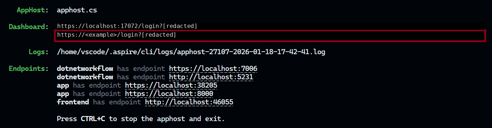
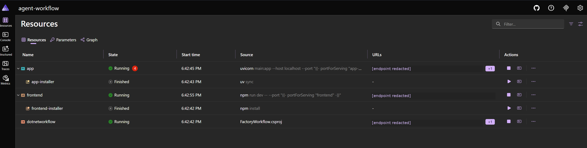
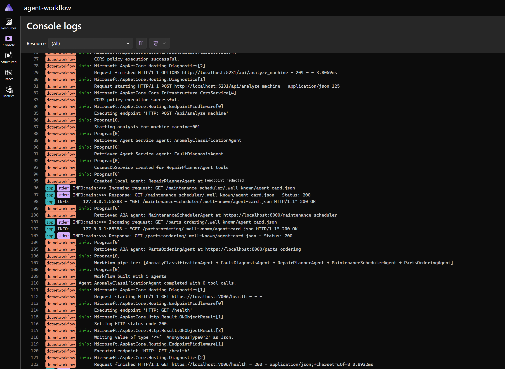
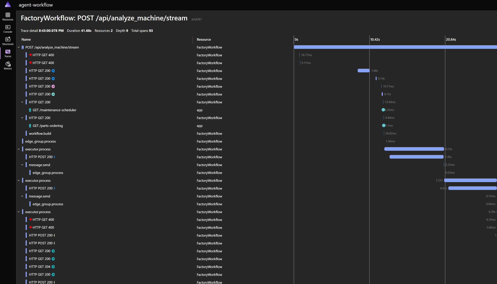

# Task 5：檢視 dashboard {#observe-dashboard}

## 目標 {#goal}

從 Aspire dashboard 追蹤 Task 4 的同一次操作，使用 Console 與 Traces 理解呼叫順序、耗時及錯誤位置。

## 步驟 {#steps}

### 1. 開啟 Aspire dashboard

回到執行 `aspire run` 的 Terminal，使用輸出中的 Aspire dashboard（儀表板）連結。
請在 **VM 內的瀏覽器**開啟，或回到 Task 1 已開啟的 dashboard。

{ .workshop-figure width="1351" height="352" loading="lazy" }

*圖片 1：原始教材示意畫面：Dashboard URL 的位置；實際連結請從自己的 Aspire Terminal 取得。*

### 2. 核對 Resources

確認 `app`、`dotnetworkflow` 與 `frontend` 仍在執行。
如果某個資源在 Task 4 後停止或變成不健康，先查看該資源的 Console。

{ .workshop-figure width="3022" height="767" loading="lazy" }

*圖片 2：原始教材示意畫面；自己的資源狀態與 endpoints 可能不同。*

### 3. 查看 Console

開啟 **Console／Console logs**，選擇 `dotnetworkflow`，依 Task 4 的操作時間找出本次 request。
再查看 `app`，觀察 Python A2A 呼叫、初始化或資料存取問題。

可核對的重點包括：

- .NET 接到哪一筆範例機台 request。
- 實際建立的 Agent 數量；目前程式會記錄 `Workflow built with ... agents`。
- 是否看到 `Workflow built with 5 agents`；若 request 失敗，記下第一個錯誤及發生位置。
- A2A Agents 是否 discovery／呼叫成功，是否出現錯誤或工單不存在。

{ .workshop-figure width="2234" height="1634" loading="lazy" }

*圖片 3：原始教材示意畫面：在 Console 查看 logs；本次訊息依實際執行結果而定。*

### 4. 查看 Traces

開啟 **Traces**，以操作時間、服務與可用的 request 資訊找到同一次呼叫。
展開 trace 的 spans，觀察 workflow、Agent invocations、HTTP 或 tool 相關紀錄。

{ .workshop-figure width="3043" height="1739" loading="lazy" }

*圖片 4：原始教材示意畫面；實際可見的 spans 依目前 instrumentation 而定。*

依畫面實際提供的資訊，回答：

1. Request 從哪個服務進入？
2. 哪些 Agent 呼叫屬於同一次操作？順序是否符合 sequential workflow？
3. 最長的 span 是哪一段？它代表模型、tool、HTTP 呼叫還是其他處理？
4. 若有失敗，哪個 span 或 log 提供第一個明確錯誤？

## Checklist {#checklist}

- [ ] 在 Console 找到本次 request，確認是否記錄 `Workflow built with 5 agents`，並確認有無錯誤；若有，記下第一個錯誤的位置。
- [ ] 在 Traces 找到對應時間與服務的 spans，以及可說明的呼叫順序與耗時。
- [ ] 區分 Agent output、tool result、HTTP 狀態與資料寫入證據，並說明 5 個 Agent 是否達到核對條件。

## 下一步 {#next}

閱讀 [結論](../review.md)，整理本次流程與觀察結果。

## 疑難排解 {#troubleshooting}

??? question "看不到本次 trace"
    確認 Task 4 真正呼叫 API，而不是只按了 `Load Demo`。
    核對服務、時間範圍與 Console 是否有本次 request，再請講師確認 OpenTelemetry 設定與資料接收。
    沒有 trace 不代表操作成功，也不能只依 UI 的完成字樣判定。

??? question "Logs 顯示五步完成，但某個工具結果失敗"
    流程執行結束與業務成功是兩件事。
    回到 [Task 4](task-4-run-workflow.md)，核對具體 tool result、工單 ID 與後續傳遞，記錄失敗而不是忽略它。
